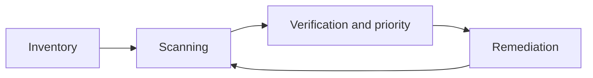

# Vulnerability scanning

**Vulnerability scanning** is the process of examining systems for known flaws (CVEs), misconfigurations, outdated software and weak passwords. A scanner automates detection, but it does not replace a manual test: it will not understand business logic or chain several small flaws together.

!!! warning "Scope and authorisation"
    Scan only systems you own or have written permission to test. A scan is an active operation on the infrastructure and can be intrusive: it may destabilise a service. Before you start, agree the scope (addresses, time windows, exclusions), the credentials and a point of contact.

## Comparing tools

| Tool | Vendor | Model | Notes |
|---|---|---|---|
| **Nessus** | Tenable | commercial | broad CVE coverage, fix suggestions, reports, scan templates |
| **Greenbone OpenVAS** (Community Edition) | Greenbone | open source | free, good for small companies, less CVE coverage than Nessus |
| **InsightVM** (formerly Nexpose) | Rapid7 | commercial | a "Real Risk" score, dynamic asset discovery, Metasploit integration, SCAP compliance |

In my own lab (a Metasploitable target) Nessus gave the broadest coverage and the fewest false positives, OpenVAS worked well as a free alternative, and Nexpose (Rapid7's older on-premises product) worked well together with Metasploit. This is an observation from one environment, not a general ranking.

## Types of scan

- **Unauthenticated**: the scanner sees the system "from the outside", like an anonymous attacker. Fast, but finds less (mainly network exposure and visible version banners).
- **Authenticated**: the scanner logs in with credentials and reads package versions, configuration and installed patches. It finds considerably more and yields fewer false positives; it requires secure management of the scanner account (least privilege, password rotation).

## Risk scoring

- **CVSS** (a 0–10 scale) describes the severity of a vulnerability. Scanners usually report the *base* score, which does not account for the environment. It is adjusted by the threat metrics (in CVSS 4.0, e.g. exploit maturity; the temporal metrics in v3.1) and the *environmental* metrics (exposure and asset criticality). InsightVM adds its own "Real Risk".
- Prioritise by real risk (exposure, asset criticality and whether it is being actively exploited in the wild, e.g. KEV lists, the EPSS forecast), not by the base score alone.
- The scanner's output must be verified: false positives, false negatives and vulnerabilities that are not relevant in a given context are normal.

## Where it fits in the process

- Regularity and rescanning after a fix matter more than a single report.
- A scanner is one part of vulnerability management, alongside manual testing and monitoring.

## Recommendations

- Keep an up-to-date asset inventory; scan regularly and after every major change.
- Verify results manually and prioritise by real risk, not just the CVSS score.
- Combine scanning with manual testing: the tool finds known CVEs, a human finds logic flaws.
