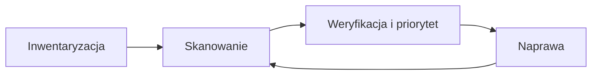

# Skanowanie podatności

**Skanowanie podatności** to proces badania systemów pod kątem znanych luk (CVE), błędów konfiguracji, przestarzałego oprogramowania i słabych haseł. Skaner automatyzuje wykrywanie, ale nie zastępuje testu manualnego: nie zrozumie logiki biznesowej ani nie połączy kilku drobnych błędów w łańcuch.

!!! warning "Zakres i autoryzacja"
    Skanuj wyłącznie własne systemy lub te, na których skanowanie masz pisemną zgodę. Skan jest aktywnym działaniem na infrastrukturze i bywa inwazyjny: może zdestabilizować usługę. Przed startem ustal zakres (adresy, okna czasowe, wyłączenia), poświadczenia i osobę kontaktową.

## Porównanie narzędzi

| Narzędzie | Producent | Model | Uwagi |
|---|---|---|---|
| **Nessus** | Tenable | komercyjny | szerokie pokrycie CVE, sugestie naprawy, raporty, szablony skanów |
| **Greenbone OpenVAS** (Community Edition) | Greenbone | open source | darmowy, dobry dla małych firm, mniejsze pokrycie CVE niż Nessus |
| **InsightVM** (dawniej Nexpose) | Rapid7 | komercyjny | ocena „Real Risk”, dynamiczne wykrywanie zasobów, integracja z Metasploit, zgodność ze SCAP |

We własnym laboratorium (cel Metasploitable) Nessus dał najszersze pokrycie i najmniej fałszywych alarmów, OpenVAS sprawdził się jako darmowa alternatywa, a Nexpose (lokalna, starsza wersja produktu Rapid7) dobrze współpracował z Metasploit. To obserwacja z jednego środowiska, nie ogólny ranking.

## Rodzaje skanów

- **Nieuwierzytelnione**: skaner widzi system „z zewnątrz”, jak anonimowy atakujący. Szybkie, ale wykrywa mniej (głównie ekspozycję sieciową i widoczne banery wersji).
- **Uwierzytelnione**: skaner loguje się poświadczeniami i czyta wersje pakietów, konfigurację oraz zainstalowane poprawki. Wykrywa znacznie więcej i daje mniej fałszywych alarmów; wymaga bezpiecznego zarządzania kontem skanera (minimalne potrzebne uprawnienia, rotacja haseł).

## Ocena ryzyka

- **CVSS** (skala 0–10) opisuje dotkliwość podatności. Skanery podają zwykle wynik *bazowy*, który nie uwzględnia środowiska. Korygują go metryki zagrożenia (w CVSS 4.0 np. dojrzałość exploita; w v3.1 metryki czasowe) oraz *środowiskowe* (ekspozycja i krytyczność zasobu). InsightVM dokłada własne „Real Risk”.
- Priorytetyzuj po realnym ryzyku (ekspozycja, krytyczność zasobu oraz to, czy istnieje aktywnie wykorzystywany exploit, np. listy KEV, prognoza EPSS), a nie po samym wyniku bazowym.
- Wynik skanera trzeba zweryfikować: wyniki fałszywie dodatnie (false positives), wyniki fałszywie ujemne (false negatives) i podatności nieistotne w danym kontekście są normą.

## Miejsce w procesie

- Regularność i ponowne skany po naprawie są ważniejsze niż pojedynczy raport.
- Skaner to element zarządzania podatnościami, obok testów manualnych i monitoringu.

## Rekomendacje

- Prowadź aktualną inwentaryzację zasobów; skanuj regularnie i po każdej większej zmianie.
- Weryfikuj wyniki ręcznie i priorytetyzuj według realnego ryzyka, nie tylko wyniku CVSS.
- Łącz skanowanie z testami manualnymi: narzędzie znajdzie znane CVE, człowiek znajdzie błędy logiki.
