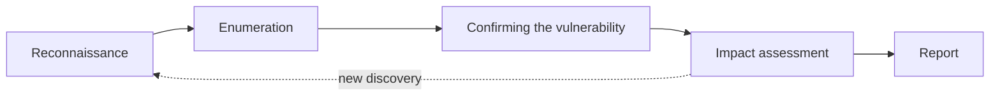

# Penetration test methodology

A **penetration test** is a controlled attempt to find and confirm vulnerabilities in a system, carried out with the owner's permission, within an agreed scope and time window. The result is a [report](pentest_report.md) describing the vulnerabilities, with recommendations.

## Before the test

The agreement is written down as the **Rules of Engagement** (RoE), which together with the written permission authorises the test:

- **Written permission and scope**: addresses, environment (test or production), accounts, time window, contacts.
- **Exclusions**: what must not be done (e.g. DoS tests, social engineering, attacks on external SSO services).
- **Contacts and abort conditions**: whom to contact if something breaks, and when testing is paused.
- **Handling sensitive findings**: if real personal data or signs of a prior breach appear, stop and notify the client.
- **Test accounts** for every role (e.g. administrator, customer, employee), to compare their permissions.

## Test types

| Type | What the tester knows | When |
|---|---|---|
| **Black-box** | only the application address | simulating an outside attacker |
| **Grey-box** | accounts and basic documentation | the most common variant, the best ratio of time to results |
| **White-box** | also the source code and configuration | security audit, code review |

## Phases

1. **Reconnaissance**: walk through every function of the application with the proxy on ([Burp Suite](../tools/burp_suite.md)) and build a map of endpoints, parameters, cookies and tokens. Response headers (`Server`, `X-Powered-By`, `Via`) reveal the technologies.
2. **Enumeration**: look for hidden resources (`robots.txt`, file copies, admin panels) with tools such as ffuf or feroxbuster, and find out which parameters the server accepts and how it reacts to changes.
3. **Confirming the vulnerability**: controlled experiments, one change at a time, compared with a baseline response. The goal is minimal proof (PoC), not maximum damage.
4. **Impact assessment**: what an attacker really gains (reading other people's data, modification, account takeover) and which conditions they must meet.
5. **Report**: description, reproduction steps, evidence, a recommended fix.

!!! note "Standards"
    Base the order and scope of testing on the **OWASP Web Security Testing Guide** (WSTG) — a set of categories and checklists for web applications — and map the gaps you find to the requirements of **OWASP ASVS**. The whole process (from scoping to reporting) is framed by **PTES** (Penetration Testing Execution Standard), and confirmed techniques can be mapped to **MITRE ATT&CK** to describe them in terms of real attacker behaviour. These are in the [resources](../resources.md), and the [OWASP Top 10](owasp_top10.md) gives a map of the most common risk categories.

## Working with hypotheses

An effective test is a series of questions, not random payloads:

- What is the **source of truth** here: a cookie, a token, a role in the request, a parameter?
- What does the server **verify**, and what does it only **assume**?
- Where does the interface block something that the API lets through?
- Does the same action behave the same way for another role, or without a session?

!!! tip "Collect evidence immediately"
    For every case: the endpoint, the baseline request, the variant, the result, the conclusion, with a date and time. Keep screenshots and logs in one secured place, and mask sensitive data as you collect it. A vulnerability that cannot be reproduced does not go into the report.

## A typical pattern from the labs

Notes from CTF-style exercises show a repeating pattern:

1. information disclosure (server versions in headers, a `robots.txt` file pointing to documentation),
2. the documentation reveals default credentials or the password policy,
3. no brute-force protection makes it possible to guess a weak password,
4. after logging in, more flaws: missing permission checks, file inclusion via a parameter, an unsafe upload.

Each flaw on its own is rated low or medium, but in a chain they lead to a full compromise. The report describes them separately and also shows the chain.
