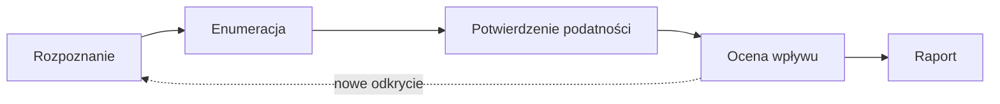

# Metodyka testu penetracyjnego

**Test penetracyjny** to kontrolowana próba znalezienia i potwierdzenia podatności w systemie, wykonywana za zgodą właściciela, w uzgodnionym zakresie i czasie. Wynikiem jest [raport](pentest_report.md) z opisem podatności i rekomendacjami.

## Przed testem

Ustalenia spisuje się w dokumencie **zasad zaangażowania** (Rules of Engagement, RoE), który razem z pisemną zgodą autoryzuje test:

- **Zgoda i zakres na piśmie**: adresy, środowisko (testowe czy produkcja), konta, okno czasowe, osoby kontaktowe.
- **Wyłączenia**: czego nie wolno robić (np. testów DoS, socjotechniki, ataków na zewnętrzne usługi SSO).
- **Kontakty i warunki przerwania**: kto odbiera zgłoszenia w razie awarii i kiedy test się wstrzymuje.
- **Postępowanie z wrażliwymi znaleziskami**: jeśli pojawią się prawdziwe dane osobowe lub ślady wcześniejszego włamania, test się zatrzymuje i powiadamia się zleceniodawcę.
- **Konta testowe** dla każdej roli (np. administrator, klient, pracownik), żeby porównać ich uprawnienia.

## Typy testów

| Typ | Co wie tester | Kiedy |
|---|---|---|
| **Black-box** | tylko adres aplikacji | symulacja atakującego z zewnątrz |
| **Gray-box** | konta i podstawowa dokumentacja | najczęstszy wariant, najlepszy stosunek czasu do wyniku |
| **White-box** | także kod źródłowy i konfiguracja | audyt bezpieczeństwa, przegląd kodu |

## Etapy

1. **Rozpoznanie** (recon): przejście wszystkich funkcji aplikacji z włączonym proxy ([Burp Suite](../tools/burp_suite.md)), zebranie mapy endpointów, parametrów, ciasteczek i tokenów. Z nagłówków odpowiedzi (`Server`, `X-Powered-By`, `Via`) widać technologie.
2. **Enumeracja**: szukanie ukrytych zasobów (`robots.txt`, kopie plików, panele administracyjne) narzędziami typu ffuf lub feroxbuster, ustalenie, które parametry serwer przyjmuje i jak reaguje na zmiany.
3. **Potwierdzenie podatności**: kontrolowane eksperymenty, jedna zmiana na raz, porównanie z odpowiedzią bazową. Celem jest minimalny dowód (PoC), a nie maksymalne szkody.
4. **Ocena wpływu**: co realnie zyskuje atakujący (odczyt cudzych danych, modyfikacja, przejęcie konta) i jakie warunki musi spełnić.
5. **Raport**: opis, kroki odtworzenia, dowody, rekomendacja naprawy.

!!! note "Standardy"
    Kolejność i zakres testów warto opierać na **OWASP Web Security Testing Guide** (WSTG) – zbiorze kategorii i list kontrolnych dla aplikacji webowych – a wykryte braki odnosić do wymagań **OWASP ASVS**. Cały proces (od ustaleń po raport) porządkuje **PTES** (Penetration Testing Execution Standard), a potwierdzone techniki warto mapować na **MITRE ATT&CK**, żeby opisać je językiem realnych działań atakującego. Publikacje są w [materiałach źródłowych](../resources.md), a mapę najczęstszych kategorii ryzyka daje [OWASP Top 10](owasp_top10.md).

## Praca na hipotezach

Skuteczny test to seria pytań, a nie losowe wysyłanie payloadów:

- Co jest tu **źródłem prawdy**: ciasteczko, token, rola w żądaniu, parametr?
- Co serwer **weryfikuje**, a co tylko **zakłada**?
- Gdzie interfejs coś blokuje, a API to przepuszcza?
- Czy ta sama akcja działa tak samo dla innej roli lub bez sesji?

!!! tip "Dowody zbieraj od razu"
    Każdy przypadek: endpoint, żądanie bazowe, wariant, wynik, wniosek, wraz z datą i godziną. Zrzuty i logi przechowuj w jednym, zabezpieczonym miejscu, a dane wrażliwe maskuj już na etapie zbierania. Podatność, której nie da się odtworzyć, nie trafi do raportu.

## Typowy wzór z laboratoriów

Notatki z ćwiczeń i zadań typu CTF pokazują powtarzalny schemat:

1. ujawnienie informacji (wersje serwera w nagłówkach, plik `robots.txt` wskazujący na dokumentację),
2. dokumentacja zdradza domyślne dane logowania lub politykę haseł,
3. brak ochrony przed brute force pozwala zgadnąć słabe hasło,
4. po zalogowaniu kolejne błędy: brak kontroli uprawnień, dołączanie plików na podstawie parametru, niebezpieczny upload.

Pojedynczo każdy błąd ma niską lub średnią istotność, ale połączone w łańcuch prowadzą do przejęcia systemu. W raporcie opisuje się je osobno i dodatkowo pokazuje łańcuch.
