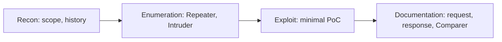

# Burp Suite

Burp Suite is the "command centre" of web application testing. It is not for firing payloads in bulk but for seeing what the application really does: what really leaves the browser, what comes back from the server, where the application trusts too much and how its behaviour changes after a small parameter tweak. These notes cover the free **Community** edition.

## Three questions worth keeping in mind

- What is the **source of truth** here: a cookie, a token, a role, a header, a parameter?
- What does the server **verify**, and what does it only **assume**?
- Where does the interface block something that the API lets through?

## Modules

| Module | What for |
|---|---|
| **Proxy** | intercepting traffic; Intercept for catching selected requests, HTTP history as the main source of discoveries |
| **Target / Site map** | a map of the application: modules, flows, places with data and permissions |
| **Repeater** | the workbench: controlled experiments, one change at a time |
| **Intruder** | throttled in Community (deliberately rate-limited); a mini-fuzzer and enumerator for short lists |
| **Decoder** | encoding and decoding: URL, Base64, hex, HTML entities |
| **Comparer** | differences between responses (e.g. blind SQLi, access control differences) |
| **Sequencer** | analysis of session token randomness |
| **Logger** | a chronological record of the traffic from all modules |

!!! note "Community edition limits"
    Intruder is throttled (deliberately rate-limited), there is no Burp Collaborator (out-of-band vulnerability detection, e.g. blind SSRF or OOB SQLi) and no automated scanner. In Community, manual precision matters, not mass request sending.

## Setup

1. Proxy → Intercept → Open Browser (the built-in browser with the proxy).
2. **Scope**: Target → Scope → Include, add the application host, exclude CDNs, analytics, external SSO. Set the proxy filters to "in scope" so the history stays uncluttered.
3. Keep Intercept off while collecting history, turn it on selectively (login, upload, role change).

## First tests (manually, in Repeater)

- **Access control / IDOR**: `GET /user/123` → `/user/124`; `accountId`, `orgId`, `invoiceId`.
- **Parameter tampering**: `price=100` → `1`, `role=user` → `admin`, `isAdmin=false` → `true`.
- **Session and permissions**: remove the cookie, swap it for another, remove the `Authorization` header, check "admin" endpoints without the role.
- **Input handling**: `'`, `"`, `\`, `../`, `%00`, long strings; in JSON change the type (`"1"` instead of `1`), remove or add fields.

## Workflow

!!! tip "The rule: one change at a time"
    Change one parameter and observe the difference. The status code is not everything: the content, headers, length and response time often matter more. Save the evidence immediately, before it disappears.

## Common mistakes

- Intercept on all the time (tiring, it breaks your concentration).
- No scope (the analysis drowns in noise).
- Five changes at once in Repeater (you cannot tell what worked).
- Looking only at the status code instead of the whole response.
- Not saving the evidence ("I had a vulnerability but cannot reproduce it").
