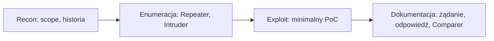

# Burp Suite

Burp Suite to „centrum dowodzenia” w testach aplikacji webowych. Nie służy do masowego wysyłania payloadów, lecz do zobaczenia, jak aplikacja naprawdę działa: co naprawdę wychodzi z przeglądarki, co wraca z serwera, gdzie aplikacja ufa za bardzo i jak zmienia się jej zachowanie po drobnej zmianie parametru. Notatka dotyczy darmowej wersji **Community**.

## Trzy pytania, które warto mieć w głowie

- Co jest tu **źródłem prawdy**: ciasteczko, token, rola, nagłówek, parametr?
- Co serwer **weryfikuje**, a co tylko **zakłada**?
- Gdzie interfejs coś blokuje, a API to przepuszcza?

## Moduły

| Moduł | Do czego |
|---|---|
| **Proxy** | przechwytywanie ruchu; Intercept do przechwytywania wybranych żądań, HTTP history jako główne źródło odkryć |
| **Target / Site map** | mapa aplikacji: moduły, przepływy, miejsca z danymi i uprawnieniami |
| **Repeater** | stół operacyjny: kontrolowane eksperymenty, jedna zmiana na raz |
| **Intruder** | w Community sztucznie spowolniony (throttling); mini-fuzzer i enumerator do krótkich list |
| **Decoder** | kodowanie i dekodowanie: URL, Base64, hex, encje HTML |
| **Comparer** | różnice między odpowiedziami (np. blind SQLi, różnice w kontroli dostępu) |
| **Sequencer** | analiza losowości tokenów sesji |
| **Logger** | chronologiczny zapis całego ruchu ze wszystkich modułów |

!!! note "Ograniczenia wersji Community"
    Intruder jest sztucznie spowolniony (throttling), nie ma Burp Collaboratora (wykrywanie podatności out-of-band, np. blind SSRF czy OOB SQLi) ani automatycznego skanera. W Community liczy się precyzja ręczna, nie masowe wysyłanie żądań.

## Konfiguracja

1. Proxy → Intercept → Open Browser (wbudowana przeglądarka z proxy).
2. **Scope**: Target → Scope → Include, dodaj host aplikacji, wyklucz CDN, analitykę, zewnętrzne SSO. Filtry proxy ustaw na „in scope”, aby historia zawierała tylko ruch z zakresu.
3. Intercept trzymaj wyłączony do zbierania historii, włączaj punktowo (login, upload, zmiana roli).

## Pierwsze testy (ręcznie, w Repeaterze)

- **Kontrola dostępu / IDOR**: `GET /user/123` → `/user/124`; `accountId`, `orgId`, `invoiceId`.
- **Manipulacja parametrem**: `price=100` → `1`, `role=user` → `admin`, `isAdmin=false` → `true`.
- **Sesja i uprawnienia**: usuń ciasteczko, podmień na inne, usuń nagłówek `Authorization`, sprawdź endpointy „admin” bez roli.
- **Obsługa wejścia**: `'`, `"`, `\`, `../`, `%00`, długie ciągi; w JSON zmień typ (`"1"` zamiast `1`), usuń lub dodaj pola.

## Przebieg pracy

!!! tip "Zasada: jedna zmiana na raz"
    Zmieniaj jeden parametr i obserwuj różnicę. Kod stanu to nie wszystko: często ważniejsze są treść, nagłówki, długość i czas odpowiedzi. Zapisuj dowód od razu, zanim zniknie.

## Najczęstsze błędy

- Intercept włączony cały czas (spowalnia pracę i rozprasza).
- Brak scope (w historii dominuje nieistotny ruch).
- Pięć zmian naraz w Repeaterze (nie wiadomo, co zadziałało).
- Patrzenie tylko na kod stanu zamiast na całą odpowiedź.
- Brak zapisu dowodu („miałem podatność, ale nie umiem jej odtworzyć”).
